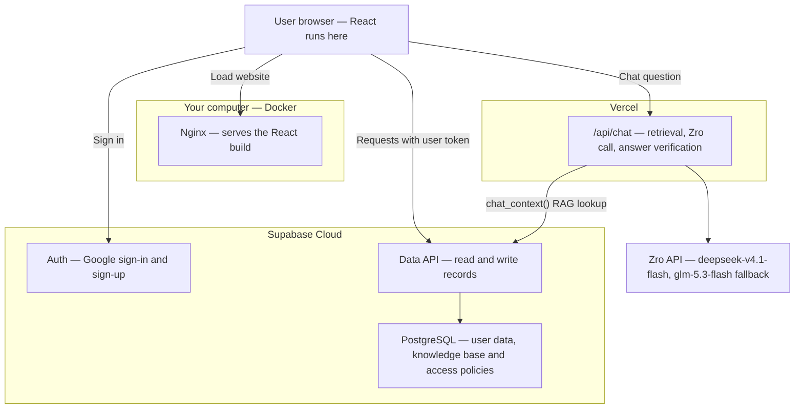

Based on your choices, start with **React in Docker + Supabase Cloud**, for signed-in users creating and managing records locally.

The Docker container serves the website files. React then runs in the browser and connects directly to Supabase. This setup supports your basic data operations without a separate backend API. [Supabase Docs](https://supabase.com/docs/guides/getting-started/quickstarts/reactjs?utm_source=chatgpt.com)

You’ll also need:

| Component | Purpose |
|---|---|
| React Router | Login, dashboard, and form pages |
| Supabase Auth (Google provider) | User accounts and sessions via Google sign-in |
| Database schema | Tables, relationships, and a user ID on owned records |
| Row Level Security | Ensure users can access only their permitted records |
| Dockerfile and Nginx configuration | Build and serve React, including page refresh support |
| Git and SQL migrations | Track application and database changes |

Use the Supabase **publishable key** in React. Keep secret/service-role keys out of the frontend, and enforce permissions through Row Level Security. [Supabase Docs](https://supabase.com/docs/guides/database/secure-data?utm_source=chatgpt.com)

Later, Kubernetes can run the same frontend image using a **Deployment and Service**, with an Ingress controller or Gateway providing website access. Supabase can remain in the cloud. [Kubernetes](https://kubernetes.io/docs/concepts/workloads/management/?utm_source=chatgpt.com) Before hosting for other users, add a domain, HTTPS, CI/CD, error monitoring, and a backup/restore plan.

**What is the actual website for, and what records will users create?** For example: expenses, bookings, products, or SRE incidents. That will determine the tables and screens in the final architecture.