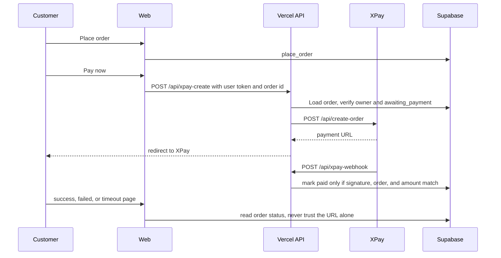

# Replace PhonePe and manual UPI with XPay

## Decision

XPay (`https://xpaygateway.store`) becomes the only customer payment path.

- Remove the PhonePe sandbox API, admin UI, tests, env example, and docs.
- Remove the manual UPI QR / UTR flow from checkout and My Orders.
- Do not commit the API key. Store it only as server env `XPAY_API_KEY`.
- Do not mark an order paid because the browser landed on `success_url`. A verified webhook, or a server-side status check, is required.

## Current flow

1. Customer submits address. `place_order` creates an order in `awaiting_payment` and reserves stock.
2. [`web/src/components/PaymentPanel.tsx`](../web/src/components/PaymentPanel.tsx) shows a UPI QR. The customer types a UTR and calls `submit_payment`.
3. An admin later calls `admin_confirm_payment`.
4. PhonePe is a separate admin-only sandbox and never updates real orders.

## Target flow

## Create-order mapping

Server-only call to `POST https://xpaygateway.store/api/create-order`:

| XPay field | Source |
|---|---|
| api_key | `XPAY_API_KEY` |
| amount | order total, two decimals |
| order_id | store order id |
| customer_mobile | `ship_phone`, digits only |
| remark | product name and short order ref |
| success_url | `{STORE_URL}/orders?payment=success&order={id}` |
| failed_url | `{STORE_URL}/orders?payment=failed&order={id}` |
| timeout_url | `{STORE_URL}/orders?payment=timeout&order={id}` |
| switch | `XPAY_SWITCH`, default `152` until the provider explains it |

The handler must allow only an HTTPS redirect URL on `xpaygateway.store`.

## Security

- API key stays on the server. The browser sends only the Supabase user token and order id.
- Webhook must be authenticated. Implementation waits for the provider's header, signature, and sample body.
- Compare gateway order id and amount in paise or decimal string before calling a service-role function that sets `paid`.
- Ignore duplicate success callbacks. Do not move `paid`, `shipped`, or `delivered` backward.
- Failed or timeout callbacks leave the order `awaiting_payment` so the customer can retry.
- Rotate the key that was pasted in chat after it is stored in Vercel.

## Removal

- PhonePe handlers, libs, scripts, [`web/phonepe.env.example`](../web/phonepe.env.example), [`docs/phonepe-sandbox.md`](../docs/phonepe-sandbox.md), and the Vite `/api/phonepe-` proxy.
- Admin Settings PhonePe panels.
- [`web/src/components/PaymentPanel.tsx`](../web/src/components/PaymentPanel.tsx), [`web/src/lib/payments.ts`](../web/src/lib/payments.ts), and UPI settings fields that exist only for the QR.
- Customer-facing GPay / UPI copy in checkout, My Orders, and README.

Keep historical `gpay_upi` rows readable. New orders use payment method `xpay`.

## Blockers before code

1. Sample JSON response from create-order, especially the payment URL field.
2. Webhook URL path expected by XPay, full sample body, and signature or auth method.
3. Meaning of `switch: 152`.
4. Whether XPay has a status API for when the webhook is missed.
